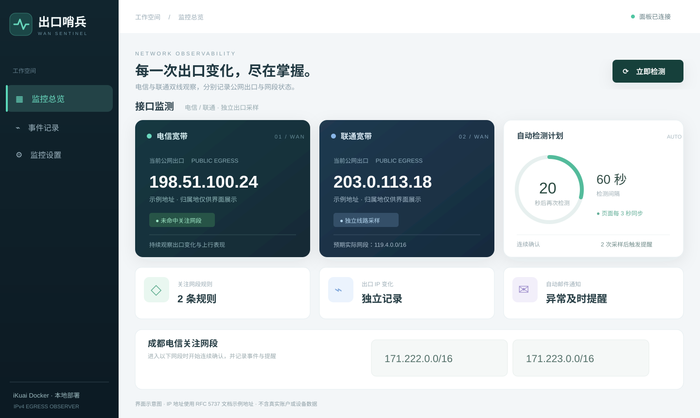
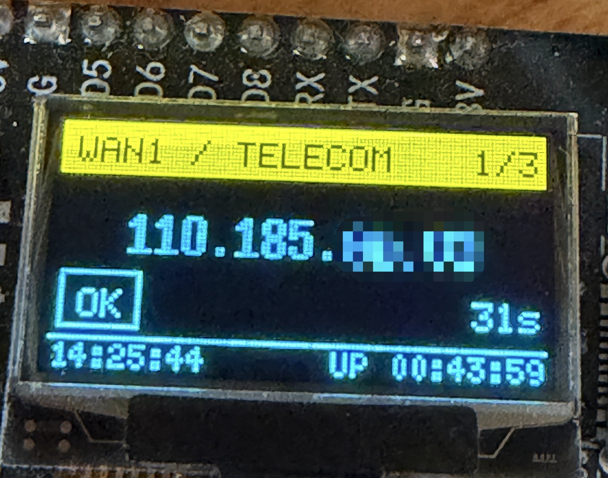
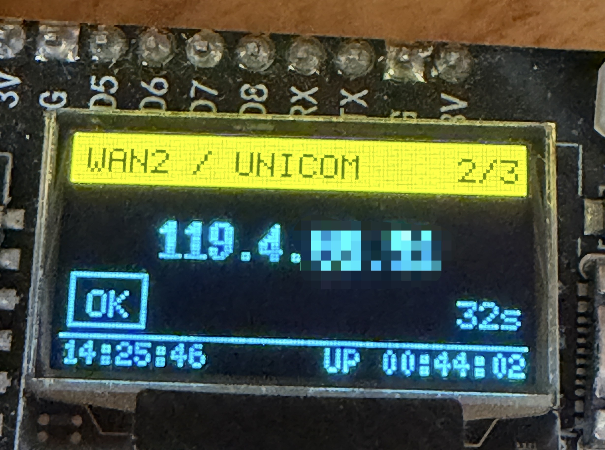
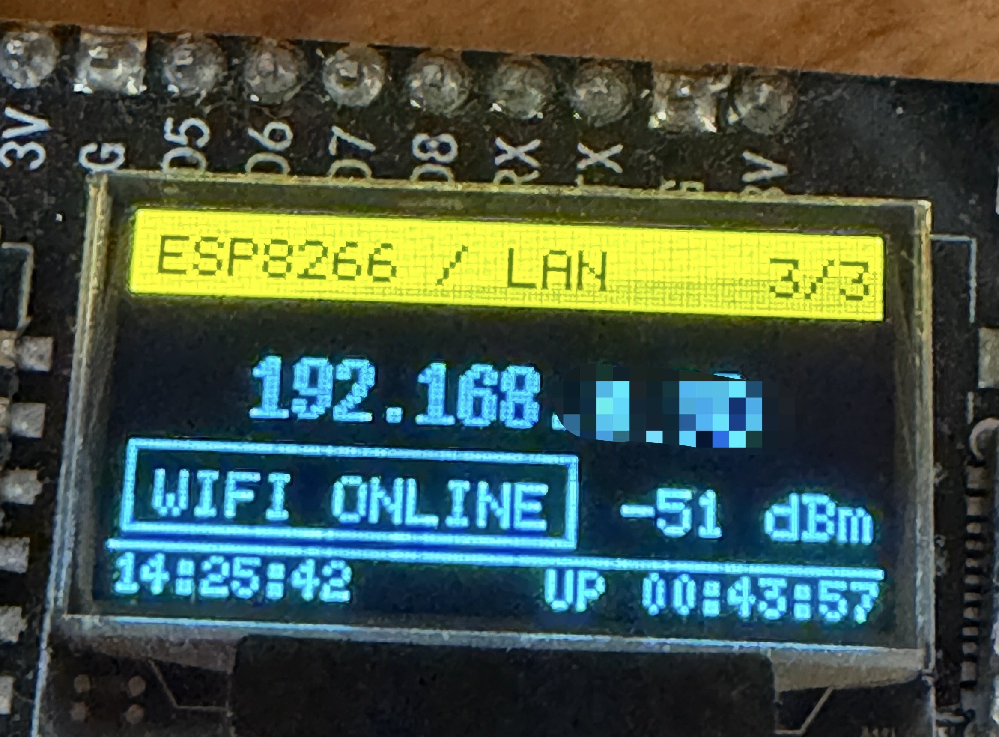

# IP Monitor

双线出口 IP 监测：iKuai Docker 提供网页、事件记录和邮件提醒；ESP8266 在屏幕上轮播电信、联通及设备本机状态。

## 项目背景

针对成都电信宽带用户反馈的高上传量后上行变慢现象，重点观察出口 IP 是否进入 `171.222.0.0/16` 或 `171.223.0.0/16`。命中后程序会连续确认并提醒，同时记录联通线路的出口变化。

IP 命中仅是排查线索，是否限速仍需测速核实。

## 功能

- 分别查询电信、联通的实际公网出口 IP 和归属地。
- 记录 IP 变化、网段命中和检测异常；通过网页查看历史事件。
- 电信或联通 IP 与上次成功检测值不同就发邮件；网段风险、恢复和检测故障也会提醒。
- ESP8266 显示 WAN1、WAN2、本机 IP、系统时间和运行时间，支持局域网 OTA。

## 效果展示



| 电信出口 | 联通出口 | ESP8266 本机状态 |
| --- | --- | --- |
|  |  |  |

网页图使用文档示例 IP；实机照片已遮挡 IP 地址后两段。

## 所需设备

- 可运行 Docker 的 iKuai 路由器或其他主机。
- 两条拨号宽带；如需同时监测，路由器须支持按源端口指定出口线路。
- 可选：ESP8266、SSD1306 128×64 OLED，及用于烧录的 PlatformIO。

## 部署监控网页

### 1. 设置登录密码和设备 Token

复制 `server/.env.example` 为 `server/.env`，修改以下值：

| 配置项 | 用途 |
| --- | --- |
| `WEB_PASSWORD` | 网页 `admin` 账号的登录密码，至少 12 字符。 |
| `DISPLAY_TOKEN` | ESP8266 读取 `/api/display` 的令牌，至少 16 字符；两端须一致。 |

示例值是随机生成的公开占位值，部署前必须换成自己的私有值。

### 2. 启动 Docker

**iKuai Docker 图形界面：**使用 `python:3.12-alpine` 镜像，将 `server/` 挂载为容器的只读 `/app`，另设可写目录挂载到 `/data`。映射端口 `8080:8080`，启动命令为 `python -u /app/web.py`，并将 `WEB_PASSWORD`、`DISPLAY_TOKEN` 设为容器环境变量。

**Docker Compose：**在 `server/` 目录执行：

```sh
docker compose up -d
```

打开 `http://路由器地址:8080`，使用 `admin` 和刚设置的 `WEB_PASSWORD` 登录。

### 3. 配置双线分流

在 iKuai 中按**源端口**配置两条 TCP 443 规则：

| 检测线路 | 源端口 | 出口 |
| --- | --- | --- |
| 电信 | `41000–41031` | 电信拨号 |
| 联通 | `42000–42031` | 联通拨号 |

配置完成后，在网页的“监控设置”中开启“双线源端口分流”。两路查询均需能访问 `myip.ipip.net:443`；否则可能都走同一条宽带，结果不可信。

### 4. 配置邮件

在“监控设置”填写 SMTP 服务器、端口、邮箱账号、**SMTP 授权码**和收件地址。先发送测试邮件，再开启自动通知。需要让 SMTP 流量经联通线路发出时，请按所选端口（通常为 465 或 587）单独设置路由规则。

首次成功检测只记录基线，不发 IP 变化邮件。之后两条线路各自比较上次成功检测的 IP；邮件发送失败会在后续检测中重试，每条线路最多保留最近 200 次待发变化。

## 部署 ESP8266 屏显

1. 在 `esp8266/` 中复制 `include/wan_config.example.h` 为 `include/wan_config.h`；复制 `ota_config.example.ini` 为 `ota_config.ini`。
2. 在 `wan_config.h` 中填写 `WIFI_SSID`、`WIFI_PASSWORD`、`MONITOR_URL`、`DISPLAY_TOKEN`、`OTA_PASSWORD`。其中 `MONITOR_URL` 指向 `http://监控服务地址:8080/api/display`，`DISPLAY_TOKEN` 与服务端相同。
3. 首次通过 USB 烧录：

   ```sh
   cd esp8266
   pio run -e esp12e -t upload
   ```

4. 后续通过 OTA 更新：在 `ota_config.ini` 中将 `upload_port` 改为 ESP8266 当前局域网 IP，然后执行 `pio run -e esp12e-ota -t upload`。上传电脑无需固定 IP，但须允许设备回连 TCP 3232。

也可以打开 `http://ESP8266的IP/`，用 `admin` 和 `OTA_PASSWORD` 登录，上传编译生成的 `.pio/build/esp12e-ota/firmware.bin`。网页 OTA 仅适合局域网使用。

OLED 软件 I²C 接线：时钟 GPIO12、数据 GPIO14。

## 验证与备份

网页中点击“立即检测”，确认两路出口分别显示；也可以在容器中执行 `python /app/monitor.py --check-telecom` 和 `python /app/monitor.py --check-unicom`。

仓库只备份程序、文档和展示图。真实 Wi-Fi 密码、网页密码、邮箱授权码、设备 Token、Docker `/data` 历史记录和编译产物不会上传。重装时需重新填写凭据，并从自己的备份恢复 `/data`。
